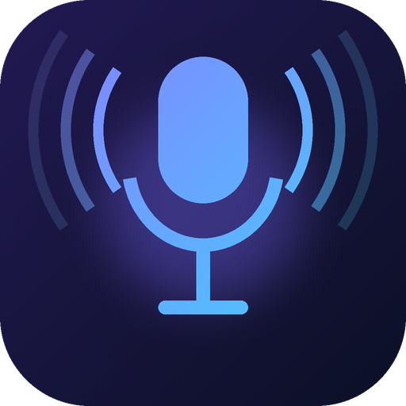

  

<h1 align="center">GameVoice</h1>

গেমের ভিতরে এক ট্যাপে ভয়েস প্যাক ও মিউজিক One-tap voice packs and music inside your game

## ফিচার / Features

- 🎤 ভাসমান বাটন ও ওভারলে প্যানেল (Floating button + overlay panel)
- 📂 ফোল্ডার, ফেভারিট ⭐, নাম বদলানো ও সরানো
- 🔊 প্রতিটি ফোল্ডারের জন্য "অপর প্রান্তে কত জোরে শুনবে" (১–১০০%) স্লাইডার, সাথে ▶ টেস্ট বাটন
- 🎧 "নিজে শুনুন" ১–১০০% স্লাইডার (অ্যাপ ও ওভারলে দুই জায়গায়)
- 🎵 স্থায়ী মিউজিক ফোল্ডার: ক্লিকেই বাজে, সিক বার, আগের/পরের, রিপিট
- 🔴 লাল ■ বাটন: সব শব্দ (গান, ক্লিপ, ভয়েস প্যাক) এক মুহূর্তে বন্ধ
- Shizuku দিয়ে সরাসরি মাইকে শব্দ (Shizuku mic injection), না হলে স্পিকার মোড

## বিল্ড / Build

রিপোতে পুশ করলে GitHub Actions নিজে APK বানায় (Actions → Build APK → Artifacts)।
`app/debug.keystore` মুছবেন না, নাহলে আপডেট ইনস্টল হবে না।

## কপিরাইট / Copyright

© 2026 হোসাইন (Hossain). সর্বস্বত্ব সংরক্ষিত — All rights reserved. বিস্তারিত: [LICENSE](LICENSE)

## যোগাযোগ / Contact

- ✉️ Email: [hossen.khl1998@gmail.com](mailto:hossen.khl1998@gmail.com)
- 📘 Facebook: [hossain.niloi](https://www.facebook.com/hossain.niloi)
- 💻 GitHub: [hossainkhan-dot/GameVoice](https://github.com/hossainkhan-dot/GameVoice)
